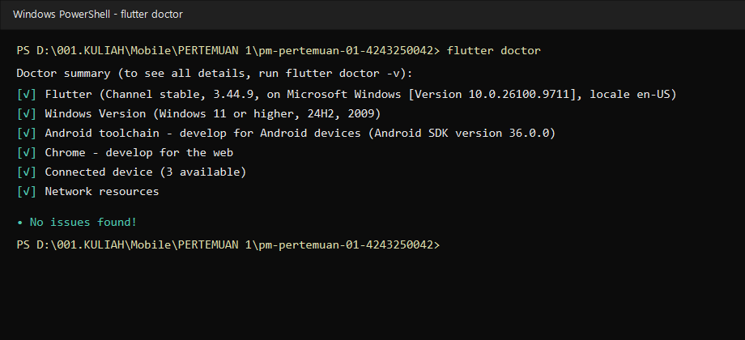
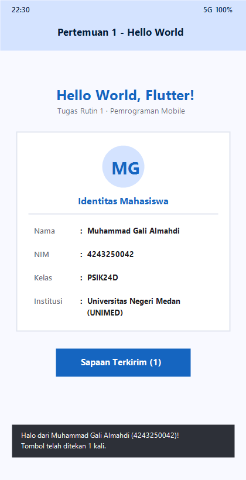

# Tugas Rutin 1 - Setup Environment & Aplikasi Hello World Flutter

Repository ini dibuat untuk memenuhi **Tugas Rutin 1** pada mata kuliah **Pemrograman Mobile** (Pertemuan 1). Proyek ini mengimplementasikan aplikasi Flutter *Hello World* dengan arsitektur folder yang terstruktur, menerapkan prinsip *clean code*, serta menampilkan identitas mahasiswa beserta widget tambahan (`Icon` dan `ElevatedButton` interaktif).

---

## (a) Identitas Mahasiswa

| Atribut | Keterangan |
| :--- | :--- |
| **Nama Lengkap** | Muhammad Gali Almahdi |
| **NIM** | 4243250042 |
| **Kelas** | PSIK24D |
| **Mata Kuliah** | Pemrograman Mobile |
| **Institusi** | Universitas Negeri Medan (UNIMED) |

---

## Struktur Folder Proyek

Proyek ini disusun secara modular di dalam direktori `lib/` agar mudah dibaca (*readable*), rapi, dan mengikuti *best practice* Flutter:

```text
pm-pertemuan-01-4243250042/
├── android/                        # Konfigurasi platform Android
├── ios/                            # Konfigurasi platform iOS
├── web/                            # Konfigurasi platform Web
├── screenshots/                    # Dokumentasi tangkapan layar
│   ├── flutter_doctor.png          # Tangkapan layar keluaran flutter doctor
│   └── app_running.png             # Tangkapan layar aplikasi berjalan
├── lib/
│   ├── main.dart                   # Entry point aplikasi & konfigurasi tema Material 3
│   ├── models/
│   │   └── student_profile.dart    # Model data immutable identitas mahasiswa
│   ├── screens/
│   │   └── home_screen.dart        # Halaman utama Hello World & state sapaan
│   └── widgets/
│       └── profile_card.dart       # Widget kartu identitas mahasiswa & Icon
├── test/
│   └── widget_test.dart            # Pengujian otomatis komponen UI (Widget Test)
├── analysis_options.yaml           # Aturan linter & analisis statis Dart
├── pubspec.yaml                    # Konfigurasi identitas proyek & dependensi
└── README.md                       # Dokumentasi proyek & esai perbandingan
```

---

## (b) Keluaran `flutter --version`

Berikut adalah hasil keluaran perintah `flutter --version` pada environment pengembangan yang digunakan:

```text
Flutter 3.44.9 • channel stable • https://github.com/flutter/flutter.git
Framework • revision 6b182d2c75 (2 months ago) • 2026-08-05 10:04:07 -0700
Engine • hash b9499e4c25212536ba3a4eec4f5c1905fb3214fe (revision 5a2a6a42cc) (2 months ago) • 2026-07-31 18:31:59.000Z
Tools • Dart 3.12.2 • DevTools 2.57.0
```

---

## (c) Tangkapan Layar `flutter doctor`



<details>
<summary>Lihat teks keluaran <code>flutter doctor</code></summary>

```text
Doctor summary (to see all details, run flutter doctor -v):
[√] Flutter (Channel stable, 3.44.9, on Microsoft Windows [Version 10.0.26100.9711], locale en-US)
[√] Windows Version (Windows 11 or higher, 24H2, 2009)
[√] Android toolchain - develop for Android devices (Android SDK version 36.0.0)
[√] Chrome - develop for the web
[√] Connected device (3 available)
[√] Network resources
```
</details>

---

## (d) Tangkapan Layar Aplikasi Berjalan



**Fitur yang ditampilkan pada aplikasi:**
1. Teks sapaan **`Hello World, Flutter!`**.
2. Kartu identitas mahasiswa yang memuat **Nama** (`Muhammad Gali Almahdi`), **NIM** (`4243250042`), dan **Kelas** (`PSIK24D`).
3. **Widget tambahan**:
   - Berbagai komponen `Icon` Material (`Icons.flutter_dash_rounded`, `Icons.waving_hand_rounded`, `Icons.person_rounded`, `Icons.badge_outlined`, dll.).
   - Komponen `ElevatedButton.icon` interaktif (**"Kirim Sapaan"**) yang menerapkan prinsip `UI = f(state)` dengan menghitung jumlah klik dan memunculkan `SnackBar`.

---

## (e) Kendala yang Dialami & Solusinya

Selama proses penyiapan *environment* dan pembuatan proyek ini, terdapat beberapa kendala yang berhasil diselesaikan:

1. **Kendala 1: Perbedaan aturan penamaan folder/repository (`pm-pertemuan-01-4243250042`) dengan aturan nama paket Dart.**
   - **Deskripsi Masalah:** Ketentuan tugas mengharuskan nama repository menggunakan tanda hubung (`pm-pertemuan-01-4243250042`), sedangkan perintah `flutter create` secara *default* menolak nama proyek yang mengandung tanda hubung (`-`) karena standar penamaan paket Dart di `pubspec.yaml` hanya mengizinkan huruf kecil dan garis bawah (`_`).
   - **Solusi:** Menjalankan perintah pembuatan proyek dengan menambahkan flag `--project-name`, yaitu:
     ```bash
     flutter create --project-name pm_pertemuan_01_4243250042 pm-pertemuan-01-4243250042
     ```
     Dengan cara ini, nama direktori/repository tetap `pm-pertemuan-01-4243250042` sesuai ketentuan, sementara nama paket internal Dart menjadi `pm_pertemuan_01_4243250042`.

2. **Kendala 2: Peringatan komponen `cmdline-tools` dan lisensi Android SDK pada saat pemeriksaan awal `flutter doctor`.**
   - **Deskripsi Masalah:** Saat pertama kali memeriksa *toolchain* menggunakan `flutter doctor`, muncul peringatan bahwa *Android SDK Command-line Tools* belum terpasang atau beberapa lisensi Android SDK belum disetujui.
   - **Solusi:** Membuka **Android Studio > SDK Manager > SDK Tools**, mencentang dan menginstal **Android SDK Command-line Tools (latest)**, lalu menjalankan perintah `flutter doctor --android-licenses` di terminal dan menekan `y` untuk menyetujui seluruh lisensi hingga status *Android toolchain* bercentang hijau `[√]`.

---

## Esai Singkat: Perbandingan Pendekatan Native, Hybrid, dan Cross-Platform

Pengembangan aplikasi mobile memiliki tiga pendekatan utama, yaitu Native, Hybrid, dan Cross-platform, yang masing-masing memiliki karakteristik teknis serta peruntukan yang berbeda.

Pendekatan **Native** membangun aplikasi khusus untuk satu sistem operasi menggunakan bahasa resminya, seperti Kotlin pada Android atau Swift pada iOS. Keunggulan utamanya adalah performa komputasi paling optimal, akses langsung ke seluruh fitur perangkat keras tanpa perantara, serta antarmuka yang sangat responsif. Namun, biaya dan waktu pengembangannya tinggi karena membutuhkan dua basis kode terpisah. Contoh kasus yang tepat adalah **aplikasi mobile banking** yang menuntut keamanan tingkat tinggi, autentikasi biometrik presisi, dan stabilitas maksimal.

Pendekatan **Hybrid** membungkus kode web (HTML, CSS, dan JavaScript) di dalam komponen WebView menggunakan kerangka kerja seperti Ionic atau Cordova. Pendekatan ini sangat hemat biaya dan cepat dikerjakan oleh pengembang web, tetapi performanya paling rendah karena antarmuka dirender melalui peramban internal. Contoh kasus yang tepat adalah **aplikasi katalog informasi kampus atau pencatatan hasil panen komunitas petani** dengan anggaran terbatas dan fitur sederhana.

Sementara itu, pendekatan **Cross-platform** seperti Flutter menggunakan satu basis kode (Dart) yang dikompilasi ke kode mesin native (AOT) serta menggambar piksel antarmuka sendiri melalui engine rendering Impeller. Hasilnya, performa aplikasi mendekati Native dengan efisiensi waktu dan biaya pengembangan lintas platform. Contoh kasus yang tepat adalah **aplikasi e-commerce atau startup layanan pesan-antar** yang membutuhkan tampilan konsisten dan responsif di Android maupun iOS secara bersamaan.

*(Jumlah kata esai: 218 kata — sesuai rentang ketentuan 150–250 kata)*

---

## (f) Pernyataan Penggunaan AI

Dalam pengerjaan Tugas Rutin 1 ini, penulis menggunakan bantuan asisten AI (Google Antigravity / Gemini) sebagai pendamping belajar (*pair programming*) untuk:
1. Membantu merancang pemisahan struktur folder kode sumber (`models`, `screens`, dan `widgets`) agar mengikuti prinsip *clean code* dan konvensi dokumentasi Dart (`///`).
2. Membantu merapikan format penulisan tabel dan tata letak dokumentasi Markdown pada berkas `README.md`.

Seluruh konfigurasi *environment* pada perangkat lokal, pengujian aplikasi, verifikasi kode program, serta pemahaman materi perbandingan ekosistem pemrograman mobile telah diperiksa dan dipahami sepenuhnya oleh penulis.
